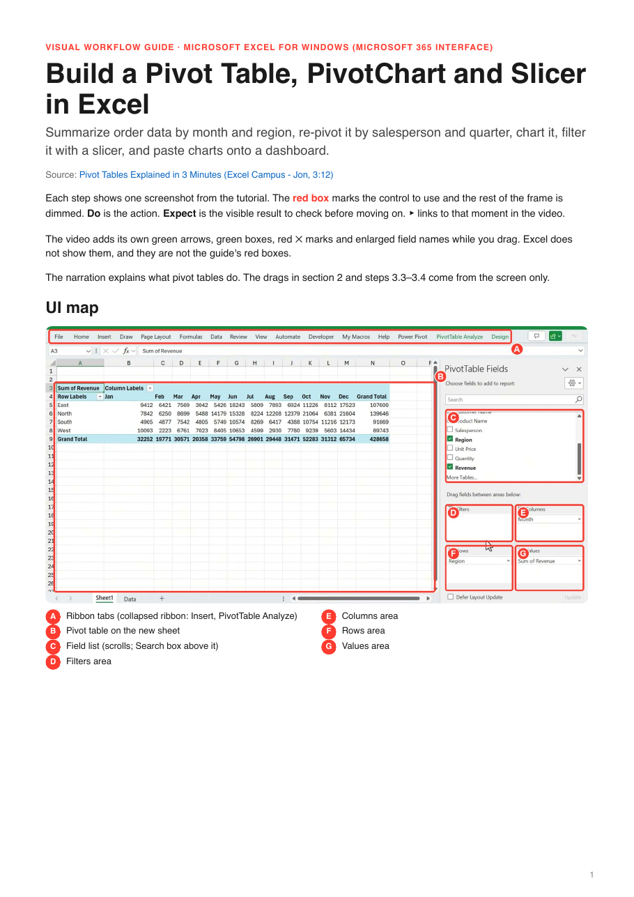
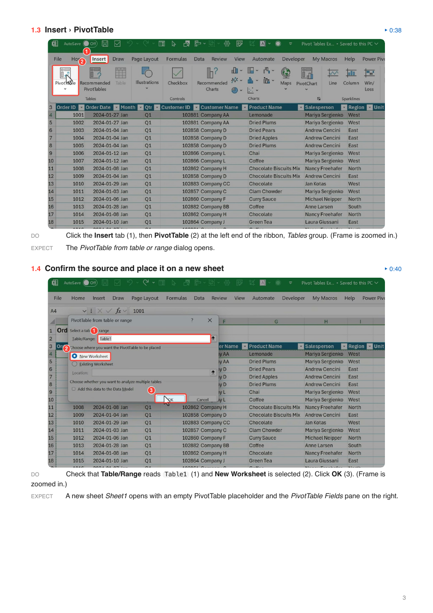

# A skill is a folder that the agent reads in three steps

You have 40 skills installed in Claude Code. You open a new session and type nothing. How much of the context window do those 40 skills use already?

Write down a number before you read on, in tokens or as a percentage of the window. A rough guess is fine. The end of this post comes back to it.

<!-- more -->

The usual definition says a skill is a folder that holds a SKILL.md file. That definition is true and too small. It says nothing about the order in which the agent reads the folder. The order decides what a skill costs.

This post takes apart two skills from my own `~/.claude/skills/` folder. `explain-simply` is a single file. `video-guide` turns a link to a software tutorial into a PDF with one annotated screenshot per click, and I run it almost every week.

## Two folders

```text
explain-simply/
└── SKILL.md                            46 lines
```

```text
video-guide/
├── SKILL.md                           109 lines
├── README.md                          100 lines
├── LICENSE                             22 lines
├── scripts/
│   └── video_guide.py                 431 lines
├── references/
│   ├── steps-schema.md                 53 lines
│   ├── example-steps.json             150 lines
│   └── transcription.md                17 lines
├── evals/
│   └── evals.json                      56 lines
└── examples/
    └── excel-pivot-table-guide.pdf     the sample guide
```

One skill has 46 lines. The other has 938 lines of text plus a PDF. I use both.

## What the bigger folder makes

I gave `video-guide` a 3-minute YouTube tutorial, "Pivot Tables Explained in 3 Minutes" from the Excel Campus channel. This is the cover of the PDF it returned, and one page of steps:





Four parts of the PDF trace back to files in the tree:

- The red boxes and numbered badges on the screenshots. The `render` command in `scripts/video_guide.py` draws them.
- The **Do** and **Expect** lines under each screenshot. Claude writes them from the rules in step 4 of the SKILL.md body and the fields in `references/steps-schema.md`.
- The intro line on the cover. Line 92 of SKILL.md tells Claude to copy it from `references/example-steps.json`.
- The quick reference and the agent notes on the last page. Line 93 of SKILL.md asks for them.

## The three steps

1. **The listing, always.** When a session starts, Claude Code reads the frontmatter of every installed skill. The `name` and `description` go into a listing that Claude sees on every request. Anthropic's docs estimate about 100 tokens per skill ([overview](https://platform.claude.com/docs/en/agents-and-tools/agent-skills/overview)).
2. **The body, when the skill fires.** Claude compares your request with the descriptions in the listing. When one matches, Claude Code loads the body of that SKILL.md, plus a line with the path to the skill's folder. The body stays in the conversation for the rest of the session, and Claude does not re-read it on later turns ([skills docs](https://code.claude.com/docs/en/skills)). The docs suggest a body under 5k tokens and under 500 lines. `video-guide` has 109 lines.
3. **Files, when a step asks.** References, scripts and assets cost zero tokens until a step points Claude at one. The `video-guide` body points at its four bundled files in four lines (8, 22, 50 and 85). Files with no pointer stay on disk.

To test yourself, label each file in the `video-guide` tree before you read the table below. Use **A** for always, **F** for when the skill fires and **S** for only when a step asks for it. A few files fit none of the three. SKILL.md gets two labels, one for its frontmatter and one for its body.

You can check the labels with `grep`. I searched the `video-guide` SKILL.md for the names of the other files:

```bash
grep -n -o -E '(references|scripts|evals|examples)/[a-z_.-]+|README|LICENSE' video-guide/SKILL.md
```

```text
8:references/example-steps.json
22:scripts/video_guide.py
22:scripts/video_guide.py
50:references/transcription.md
85:references/steps-schema.md
85:references/example-steps.json
```

The number before each colon is a line in SKILL.md. Each of those four lines points Claude at the files it names. No step sends Claude to a file the body never names. The same `grep` on `explain-simply/SKILL.md` prints nothing.

| File | When Claude reads it | Why |
|---|---|---|
| `explain-simply/SKILL.md`, frontmatter (lines 1–4) | A | The listing holds every skill's name and description. |
| `explain-simply/SKILL.md`, body (42 lines) | F | It loads when a request matches the description. |
| `video-guide/SKILL.md`, frontmatter (lines 1–4) | A | Same as above. |
| `video-guide/SKILL.md`, body (105 lines) | F | Same as above. |
| `references/example-steps.json` | S | Line 8 names it as the reference result to match. Line 85 sends Claude to it at step 4. |
| `scripts/video_guide.py` | S | Line 22 tells Claude how to run it. Claude runs it and reads the output. The code stays unread. |
| `references/transcription.md` | S | Line 50 sends Claude there only when the narration carries steps the screen does not show. |
| `references/steps-schema.md` | S | Line 85: "Read `references/steps-schema.md` for the fields and `references/example-steps.json` for density and tone." |
| `README.md`, `LICENSE` | – | Written for the person who installs the skill. |
| `evals/evals.json` | – | Test cases for the skill's author. |
| `examples/excel-pivot-table-guide.pdf` | – | A sample for you to read. |

The script gets an **S**. Claude runs it without reading its 431 lines of code.

## Why most of a skill costs nothing

You might picture every installed skill sitting in the context window all the time. Only the listing entry sits there. The body loads only after a match. The references, the assets and the script code load only when a step needs them, and some files never load at all. In Claude Code even the listing entry can shrink to a bare name.

Before it fires, a skill costs its listing entry and nothing else. The length of the description sets that cost. `explain-simply` has a 462-character description. `video-guide` has an 899-character description. Its script and its 220 lines of references add nothing until a step uses them. On my machine a test skill with a 117-character description cost about 40 tokens in the listing. The longest description that kept its place cost about 480.

After it fires, a small skill stays cheap. `explain-simply` adds a 42-line body and has nothing else to load. `video-guide` adds 105 lines, then pulls in a reference or a script output at the step that needs it.

### A script costs only its output

Claude runs a bundled script through bash, and only the script's output enters the context ([overview](https://platform.claude.com/docs/en/agents-and-tools/agent-skills/overview)). `video_guide.py` has 431 lines of Python. When Claude runs its `check` command, Claude reads seven lines. This is what `check` printed on my Mac:

```text
ok  ffmpeg 9.0.2
ok  ffprobe 9.0.2
ok  weasyprint 70.0
ok  pdftoppm 26.10.0
ok  deno 2.9.7
ok  pillow 12.3.0
ok  yt-dlp 2026.8.19
```

Those seven lines are the whole cost. For this reason the script does the repetitive work of `video-guide`. It downloads the video, cuts frames, draws boxes and builds the PDF.

## Measure what your own skills cost

Run this in a terminal (tested with Claude Code 2.1.283, October 2026):

```bash
claude -p "/context" > context.txt
grep "| Skills" context.txt
grep -c "< 20" context.txt
```

The first `grep` prints the Skills row: the tokens that your skills' names and descriptions use, and their share of the context window. The second counts the rows that show `< 20` tokens. My Skills row, on Sonnet with a 1M-token window:

```text
| Skills | 9.9k | 1.0% |
```

My count was 263, out of 310 skills. Open `context.txt` and scroll to the `### Skills` table to see one row per skill. Three of my rows:

```text
| anki | User | ~390 |
| explain-simply | User | < 20 |
| video-guide | User | < 20 |
```

`/context` also works inside a session. `/skills` lists every skill, and pressing <kbd>t</kbd> sorts the list by token count ([commands docs](https://code.claude.com/docs/en/commands)).

## Back to the prediction

Anthropic's estimate is about 100 tokens per skill, so 40 skills come to about 4,000 tokens. That is 0.4% of a 1M-token window.

Claude Code also caps the listing at 1% of the context window. When the descriptions do not fit, it keeps every name and drops the descriptions of the skills you use least ([settings reference](https://code.claude.com/docs/en/settings-reference)). On a 200k-token window, 1% is 2,000 tokens. Forty descriptions at 100 tokens each already pass that cap.

If you guessed a few thousand tokens, you were close. If you guessed tens of thousands, you pictured whole SKILL.md files in the context.

My own numbers (tested with Claude Code 2.1.283, October 2026): 310 skills in the listing, a Skills row of 9.9k tokens, 1.0% of Sonnet's 1M window. The row sat at the cap. Claude Code had cut the descriptions of 263 skills and kept only their names. `video-guide` was one of the 263, even though I run it almost every week.

The listing costs tokens, and it has a cap. Past the cap, a skill keeps its name and loses the description Claude matches requests against. Claude then sees `video-guide` without "even if they never say PDF" or any other trigger phrase. When a skill stops firing on a machine with many skills, check `/context` or `/skills` first. The cap may have cut its description.

## What a skill must contain, and where it lives

SKILL.md is the only required file. `scripts/`, `references/` and `assets/` are optional, and a skill has them only when its job needs them ([spec](https://agentskills.io/specification)). The open spec requires `name` and `description` in the frontmatter, and `name` must match the folder name. Claude Code requires neither field. It takes the folder name as the name. Without a description it uses the first non-empty line of the body.

Write both anyway. The name and the description are all Claude sees before the skill fires. Anthropic's docs say the description ["must include both what the Skill does and when Claude should use it."](https://platform.claude.com/docs/en/agents-and-tools/agent-skills/overview)

The folder's location decides where the skill works. `~/.claude/skills/<name>/` works in every project on your machine. `.claude/skills/<name>/` inside a repo works in that project. A plugin carries its own `skills/` folder. The docs list a few more locations, such as enterprise settings and folders added with `--add-dir`.

## Pick a task that earns a skill

A task earns a skill when you repeat it and can check its output without doing the task again. A skill runs many steps while you are not watching. If the only way to check its output is to do the task yourself, the skill saves you nothing.

List three tasks you repeat each week that end in an output you can check. Write the input, the output and the check for each one. Two from my own list:

- **Research report.** Input: a topic. Output: an HTML report in which every citation is a deep link to the passage it cites. Check: I click a citation and land on the paragraph.
- **Quiz before cards.** Input: a paper I just read. Output: a quiz score, then Anki cards for the questions I missed. Check: every card traces back to a wrong answer. I only make cards for the holes now.

`video-guide` fits the same pattern. The input is a tutorial link and the output is a PDF. I check it by following the PDF in the app with the video closed.

This post is the free first lesson of my course [Agent Skills Field Guide](https://www.automatalearninglab.com/courses/agent-skills-field-guide). In lessons 2 to 6 you install `video-guide`, make the same pivot-table guide on your own machine, and then build and test your own skill from one task on your list.

---

[Subscribe to my Newsletter](https://automata-learning-lab.kit.com/ccd5287996){ .md-button .md-button--primary }
[Subscribe to my YouTube](https://www.youtube.com/@automatalearninglab){ .md-button .md-button--secondary }
